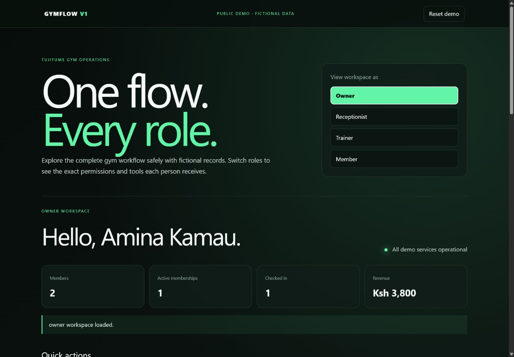
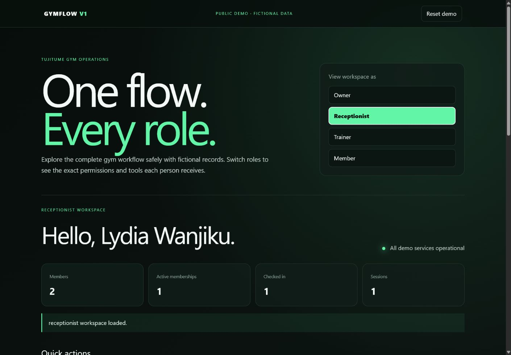
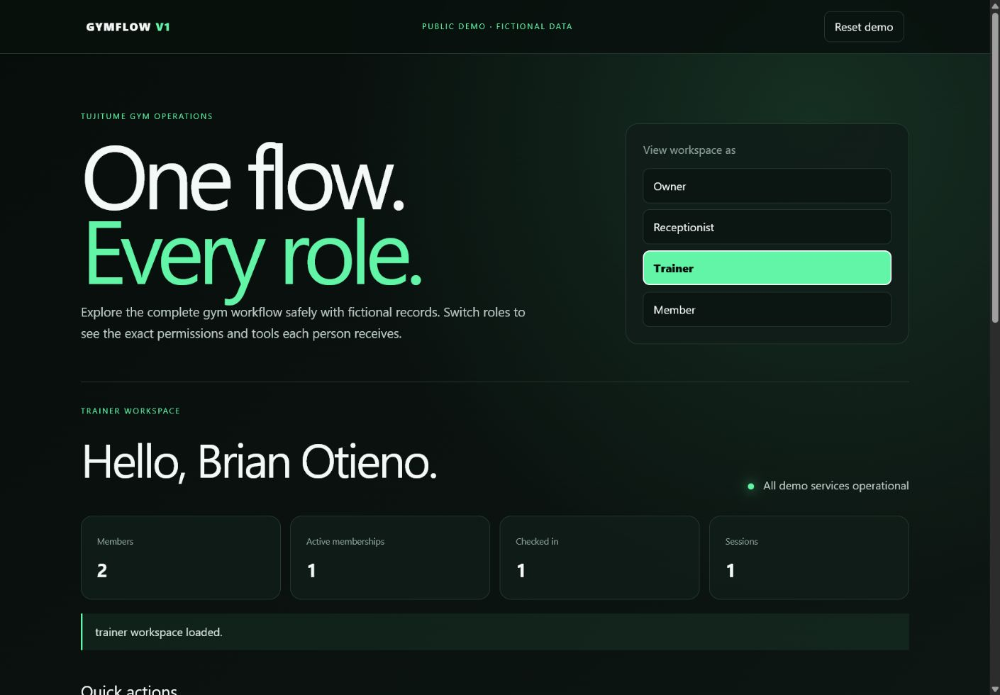
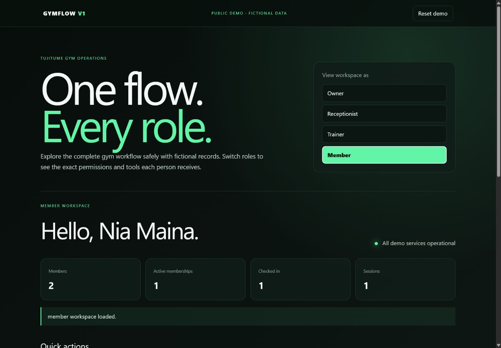

## The problem

Many Kenyan gyms run on paper registers, spreadsheets and WhatsApp. Memberships expire without anyone noticing. Check-ins are not recorded. The owner has no clear view of revenue.

## What I built

One system with four workspaces. Each person sees only what their job needs:

- **Owner:** revenue, members, expenses, staff accounts, reports and CSV export.
- **Front desk:** registration, renewals, payments and check-ins.
- **Trainer:** assigned members, schedules and workout plans. No access to money.
- **Member:** their membership, visits, bookings, workouts and progress.

Other features:
- Group classes with bookings, waitlists and class attendance.
- Lead and referral tracking with WhatsApp follow-up.
- Two-factor sign-in with recovery codes, email password reset and new-device alerts. Two-factor keys are encrypted at rest.
- In-app notifications, the gym's privacy notice and terms where people sign in or join, and an offline page.
- Automatic membership expiry, visit limits and access-hour rules, all enforced on the server.

## How it's built

- **Backend:** a Python JSON API with no framework, in separate modules for auth, operations, classes and growth.
- **Data:** PostgreSQL in production (Neon). SQLite is used for local development. Database changes run as ordered migrations.
- **Delivery:** 94 automated tests run on GitHub Actions against a real PostgreSQL 17 database. Browser tests then click through a day at the gym, and every API route is called as each role (148 checks). The app deploys to Render only when all of it passes.
- **Operations:** nightly encrypted off-site backups with tested restores, request tracing and an uptime check.

## Where it stands

The application is complete and ready to pilot with a first gym. Payments work through an M-Pesa sandbox adapter. Live M-Pesa and support for multiple gyms come after the pilot.

The public demo runs in your browser on made-up data. Nothing is sent to a server.

## Screens

